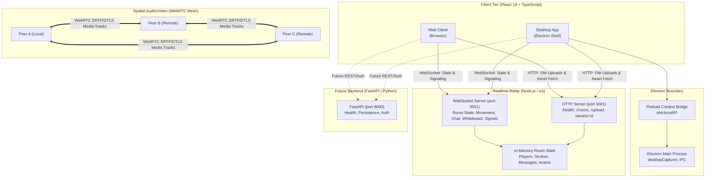
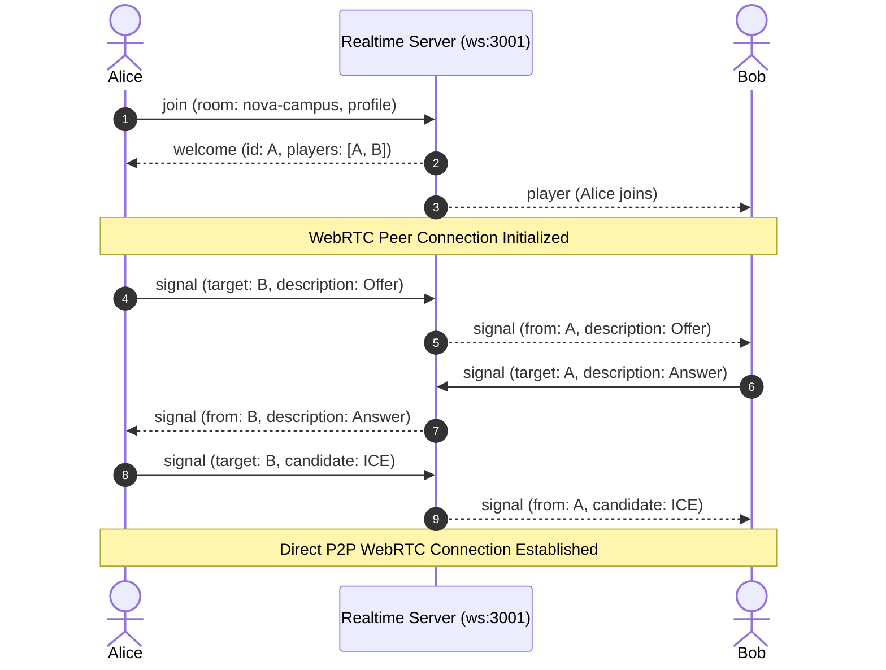

# Nova System Architecture

Nova is a shared 2D spatial workplace platform built for distributed teams. It combines an original 2D canvas-based office space, WebSocket realtime state synchronization, and a peer-to-peer WebRTC mesh for spatial audio/video collaboration.

---

## 1. High-Level Architecture Overview

Nova operates as a hybrid client-server and peer-to-peer system:
- **Client (Desktop & Web)**: React 19 + TypeScript + Vite + Canvas 2D engine with optional Electron wrapper.
- **Realtime Relay (Node.js)**: In-memory room manager, WebSocket event broker, WebRTC signaling coordinator, and temporary asset upload server.
- **Media Mesh (WebRTC)**: Direct P2P full mesh between clients for spatial audio, video, and screen sharing, governed by distance and room boundaries.
- **Persistence / REST API (FastAPI)**: Python FastAPI service intended for persistent APIs, authentication, and database services.

---

## 2. Component Breakdown

### 2.1 Apps: Desktop (`apps/desktop`)
The primary frontend application is located in `apps/desktop`. It serves both standard browser clients and native Electron desktop instances.

| Component / Module | Responsibility | Key Files |
| :--- | :--- | :--- |
| **Canvas World Engine** | Render loop, viewport camera tracking, pathfinding, player animation, collision detection, and proximity calculations. | [World.tsx](file:///c:/Users/shriv/Desktop/new-projects/nova/apps/desktop/src/world/World.tsx) [map.ts](file:///c:/Users/shriv/Desktop/new-projects/nova/apps/desktop/src/world/map.ts) [draw.ts](file:///c:/Users/shriv/Desktop/new-projects/nova/apps/desktop/src/world/draw.ts) |
| **Realtime Room Hook** | WebSocket client management, state synchronization (players, messages, whiteboard strokes, presentation), and upload handling. | [useRoom.ts](file:///c:/Users/shriv/Desktop/new-projects/nova/apps/desktop/src/hooks/useRoom.ts) |
| **Spatial Media Hook** | WebRTC peer connection pool, Perfect Negotiation, 3-slot transceiver management, proximity-based track swapping, and hardware stream control. | [useMedia.ts](file:///c:/Users/shriv/Desktop/new-projects/nova/apps/desktop/src/hooks/useMedia.ts) |
| **Collaboration UI** | Shared whiteboard canvas, PDF.js renderer, PPTX parser, screen share preview, avatar customization, and settings modal. | [Whiteboard.tsx](file:///c:/Users/shriv/Desktop/new-projects/nova/apps/desktop/src/components/Whiteboard.tsx) [PresentationView.tsx](file:///c:/Users/shriv/Desktop/new-projects/nova/apps/desktop/src/components/PresentationView.tsx) [PdfPage.tsx](file:///c:/Users/shriv/Desktop/new-projects/nova/apps/desktop/src/components/PdfPage.tsx) [AvatarPreview.tsx](file:///c:/Users/shriv/Desktop/new-projects/nova/apps/desktop/src/components/AvatarPreview.tsx) |
| **Electron Shell** | Window management, secure IPC with context isolation, native window/display capture enumeration via `desktopCapturer`. | [main.cjs](file:///c:/Users/shriv/Desktop/new-projects/nova/apps/desktop/electron/main.cjs) [preload.cjs](file:///c:/Users/shriv/Desktop/new-projects/nova/apps/desktop/electron/preload.cjs) |

### 2.2 Services: Realtime Relay (`services/realtime`)
The standalone Node.js realtime service handles live coordination:
- **WebSocket Protocol**: Custom lightweight JSON message protocol for movement, status, chat, whiteboard, presentation, and WebRTC signaling exchange.
- **Room Isolation**: Custom rooms with `scrypt`-hashed passwords. Rooms and client tokens are isolated; private rooms are excluded from public room listings.
- **Ephemeral Asset Store**: In-memory file storage supporting PDF, PNG, JPEG, WebP, and parsed JSON slide decks up to 20MB per file and 8 files per room.
- **Resource Teardown**: Automatically reclaims presentation assets and deletes custom rooms when the last player leaves.

### 2.3 Services: Persistent API (`services/api`)
- Located in `services/api`, built with FastAPI (Python 3.12+).
- Currently provides a `/health` endpoint with CORS headers configured for `http://localhost:5173`.
- Designed as a foundation for future user accounts, persistent room configurations, analytics, and enterprise directory integration.

---

## 3. Communication Pipelines

### 3.1 Signaling & State Flow
1. **Join Handshake**:
   - Client connects via `WebSocket` to `ws://localhost:3001`.
   - Client sends `{ type: 'join', roomId, password, profile }`.
   - Server authenticates, creates/retrieves room, generates participant ID and auth token, sends `{ type: 'welcome', id, token, room, players, ... }`.
   - Server broadcasts `{ type: 'player', player }` to existing room members.

2. **Movement & Animation Synchronization**:
   - Local input updates position via collision logic (`canStand`) in [map.ts](file:///c:/Users/shriv/Desktop/new-projects/nova/apps/desktop/src/world/map.ts).
   - Rate-limited movement messages (`type: 'move'`) sent every 85ms or upon state transition.
   - Remote clients linearly interpolate (LERP) coordinates in the requestAnimationFrame loop to ensure 60fps render smoothness without jitter.

3. **WebRTC Signaling Pipeline**:
   - WebRTC negotiation triggers when new players join or leave.
   - Offers, answers, and ICE candidates are relayed through WebSocket via `{ type: 'signal', target, data }`.
   - WebRTC data never touches disk; direct peer connections establish audio/video/screen RTP streams.

---

## 4. Security & Isolation Boundaries

1. **Electron Security Architecture**:
   - `nodeIntegration: false`, `contextIsolation: true`, `sandbox: true`.
   - Strict `trustedFrame` verification on all IPC calls (`nova:screen-sources`, `nova:select-screen`).
   - Content Security Policy (CSP) prevents unauthorized scripts or style injections.
2. **Room Server Security**:
   - Passwords salted with 16-byte random salt and hashed using `scryptSync(password, salt, 32)`.
   - Constant-time verification using `timingSafeEqual` prevents timing attack vulnerabilities.
   - Bearer token authentication required for HTTP asset uploads.
   - Max payload limits (128 KB for WebSocket frames, 20 MB for HTTP uploads).
   - Rate limiting: sliding 1000ms window with 90 message threshold per client, 300ms chat interval limit.

---

## 5. Deployment & Topology Considerations

- **Current Development Topology**: Localhost Node.js + Vite dev server + Electron.
- **Production Web Deployment**:
  - Expose `services/realtime/server.mjs` behind a reverse proxy (e.g., NGINX, Cloudflare) with HTTPS / WSS.
  - Set `VITE_ROOM_SERVER=https://realtime.example.com` in `apps/desktop/.env.production`.
  - Provide a production STUN/TURN server via `VITE_ICE_SERVERS` for clients behind restrictive NATs or symmetric firewalls.
  - For rooms with > 12 participants, an SFU (Selective Forwarding Unit) like LiveKit or mediasoup should replace the direct P2P mesh.
