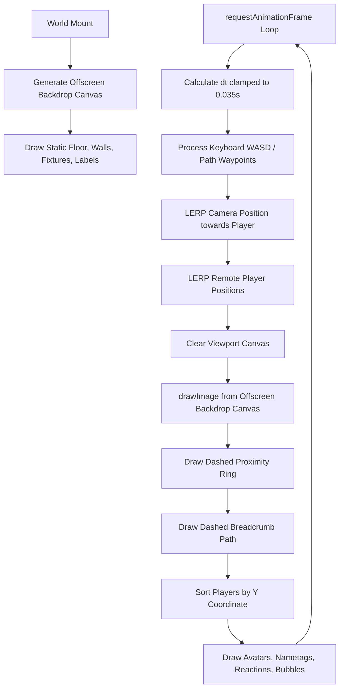

# Nova Spatial World & Rendering Engine

The Nova spatial engine provides a continuous 2D coordinate space, collision system, breadcrumb grid pathfinding, and a high-performance Canvas 2D rendering pipeline.

---

## 1. World Coordinate System & Dimensions

The virtual world exists on a fixed coordinate plane:
- **Total World Width**: `2000` units
- **Total World Height**: `1280` units
- **Coordinate Origin `(0, 0)`**: Top-left corner of the campus

```
(0,0) ----------------------------------------------------------------- (2000, 0)
|  [The Forum]          |  [Idea Studio]        |  [Quiet Garden]      |
|  (65, 65, 660x460)    |  (780, 65, 635x460)   |  (1470, 65, 465x460) |
|-----------------------+-----------------------+----------------------|
|                     Central Walkway (y: 542 - 584)                   |
|-----------------------+-----------------------+----------------------|
|  [Focus Lab]          |  [Welcome Hub]        |  [The Commons]       |
|  (65, 600, 810x605)   |  (930, 600, 485x605)  |  (1470, 600, 465x605)|
(0,1280) -------------------------------------------------------------- (2000,1280)
```

---

## 2. Campus Zones

Nova consists of 6 themed architectural zones separated by walls and connected via corridors:

| Zone ID | Display Name | Subtitle | Dimensions `(x, y, w, h)` | Entry Point | Theme Color |
| :--- | :--- | :--- | :--- | :--- | :--- |
| `stage` | **The Forum** | PRESENT & INSPIRE | `65, 65, 660, 460` | `(405, 440)` | `#d5ccef` |
| `studio` | **Idea Studio** | MAKE SOMETHING GREAT | `780, 65, 635, 460` | `(1090, 430)` | `#e5c9ad` |
| `garden` | **Quiet Garden** | TAKE A BREATH | `1470, 65, 465, 460` | `(1670, 480)` | `#a9cbb7` |
| `work` | **Focus Lab** | BIG IDEAS START HERE | `65, 600, 810, 605` | `(445, 1060)` | `#b5cdd6` |
| `hub` | **Welcome Hub** | YOUR NEXT CONNECTION | `930, 600, 485, 605` | `(1100, 950)` | `#d9d3c7` |
| `lounge` | **The Commons** | COFFEE & CONVERSATION | `1470, 600, 465, 605` | `(1690, 1100)` | `#d6b9b1` |

---

## 3. Fixtures & Interactive Objects

Fixtures represent furniture, electronics, and environmental objects:
- **Interactive Fixtures**: Contain `label` property and trigger interaction modals or state changes upon pressing `E`:
  - `screen`: Presentation display in The Forum.
  - `board`: Shared whiteboard in the Idea Studio.
  - `chair`: Seats in Forum, Studio, and Desks (toggles seated pose).
  - `desk`: Workstations in Focus Lab.
  - `coffee`: Coffee machine in The Commons (triggers thinking/coffee reaction).
- **Non-Interactive Fixtures**: Plants, decorative tables, sofas, and bookshelves.

---

## 4. Collision Detection Engine

### 4.1 Obstacle Representation
Obstacles are modeled as axis-aligned bounding boxes (AABBs):
1. **Perimeter Walls**: Boundary walls around each room.
2. **Door Openings**: Wall segments split at doorways (e.g., central 140-unit openings on corridor sides).
3. **Furniture**: Desks, tables, sofas, bookshelves, and plants. (Chairs are navigable to allow sitting).

### 4.2 Standability Testing (`canStand`)
A point `(x, y)` is walkable if a circle of radius `r = 15` centered at `(x, y)` does not intersect any obstacle and remains within world bounds:

```typescript
export function canStand(x: number, y: number): boolean {
  const r = 15;
  return (
    x > 26 &&
    y > 26 &&
    x < WORLD.width - 26 &&
    y < WORLD.height - 26 &&
    !obstacles.some(
      o => x + r > o.x && x - r < o.x + o.w && y + r > o.y && y - r < o.y + o.h
    )
  );
}
```

---

## 5. BFS Grid Pathfinding

Nova provides automatic point-and-click pathfinding in [map.ts](file:///c:/Users/shriv/Desktop/new-projects/nova/apps/desktop/src/world/map.ts).

### 5.1 Grid Discretization
- Grid resolution: `step = 25` units.
- Grid dimensions: `cols = 80`, `rows = 51` ($80 \times 25 = 2000$, $51 \times 25 = 1275 \approx 1280$).
- 1D Indexing formula: `index = y * cols + x`.

### 5.2 Algorithm Pipeline
1. **Start and Target Mapping**: Map continuous coordinates `(start.x, start.y)` and `(end.x, end.y)` to grid cells `(sx, sy)` and `(ex, ey)`.
2. **Obstacle Clamping / Fallback**: If the target cell is blocked (e.g., user clicked on a desk or wall), a local spiral search (up to 7 cells in all directions) finds the closest walkable cell.
3. **Queue-based BFS**: Explores cardinal neighbors `[dx, dy] ∈ { (1,0), (-1,0), (0,1), (0,-1) }`.
4. **Visited Map**: Tracks parent pointers `visited.set(neighbor, current)` for reverse path reconstruction.
5. **Path Unwinding**: Traverses parent pointers from target back to start, producing an array of continuous waypoint coordinates `{ x, y }`.

---

## 6. Canvas 2D Rendering Pipeline

Rendering is implemented in [World.tsx](file:///c:/Users/shriv/Desktop/new-projects/nova/apps/desktop/src/world/World.tsx) and [draw.ts](file:///c:/Users/shriv/Desktop/new-projects/nova/apps/desktop/src/world/draw.ts).



### 6.1 Offscreen Backdrop Double-Buffering
Rendering the entire campus architecture, floor patterns, room accents, and fixtures from scratch on every frame would severely impact framerates. Nova creates an offscreen canvas at mount:
```typescript
const backdrop = document.createElement('canvas');
backdrop.width = WORLD.width;
backdrop.height = WORLD.height;
drawMap(backdrop.getContext('2d')!);
```
During each animation frame, a single fast `context.drawImage(backdrop, 0, 0)` copies the pre-rendered environment onto the viewport.

### 6.2 Camera Follow with LERP
The camera smoothly tracks the active player using linear interpolation:
```typescript
camX += (aimX - camX) * Math.min(1, dt * 7);
camY += (aimY - camY) * Math.min(1, dt * 7);
```

### 6.3 2.5D Depth Sorting
To ensure correct occlusion when avatars walk in front of or behind each other, players are sorted by their Y position prior to drawing:
```typescript
const rendered = s.players.map(...).sort((a, b) => a.y - b.y);
for (const p of rendered) {
  drawPlayer(context, p, p.id === local.id, now, bubble?.text);
}
```

### 6.4 HiDPI / Retina Display Handling
Device pixel ratio is clamped to 2 (`Math.min(window.devicePixelRatio, 2)`) to prevent GPU fill-rate exhaustion on 4K/Retina displays while maintaining crisp graphics:
```typescript
const dpr = Math.min(window.devicePixelRatio, 2);
canvas.width = w * dpr;
canvas.height = h * dpr;
context.setTransform(dpr, 0, 0, dpr, 0, 0);
```
